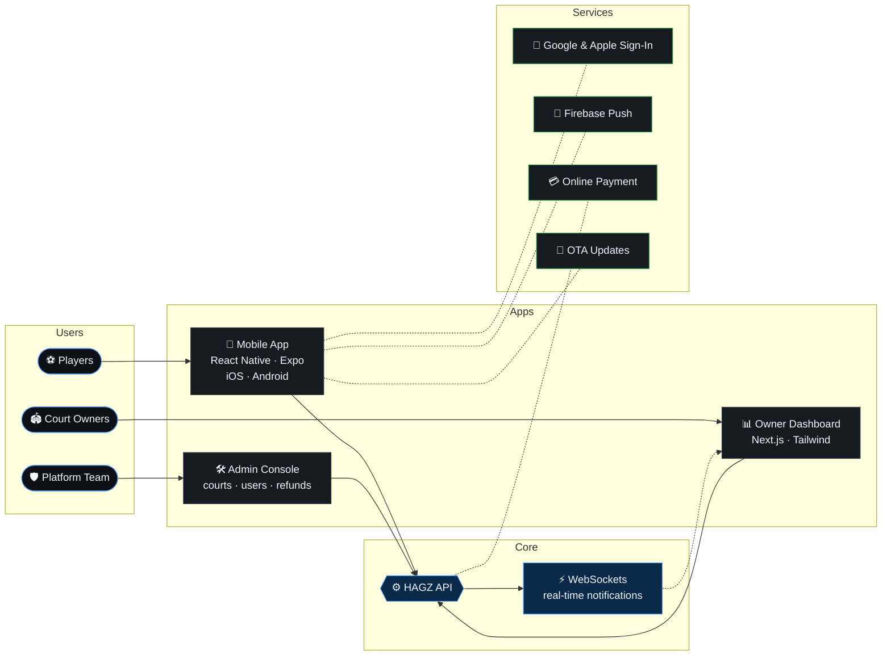
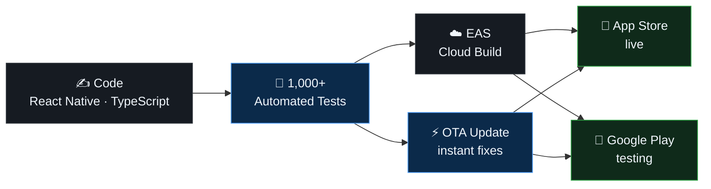
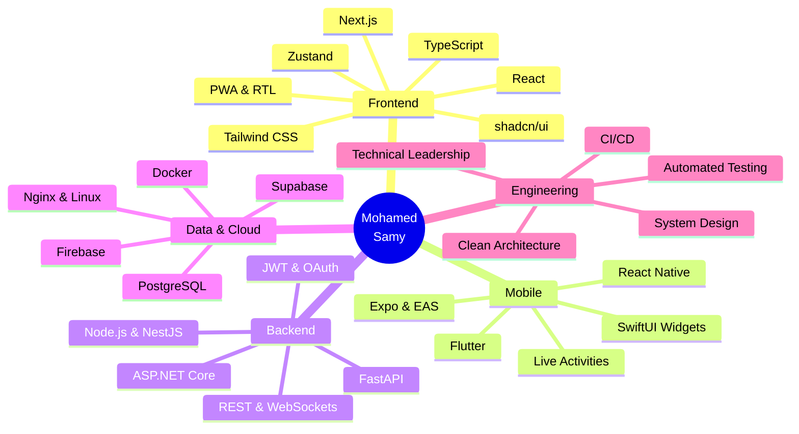
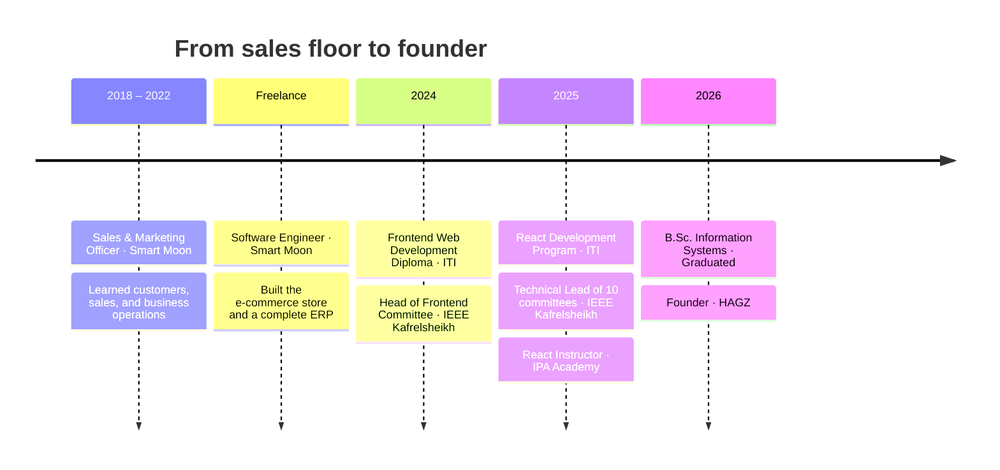

<div align="center">


<br/>

<a href="https://www.linkedin.com/in/mo72medsamy"></a>
<a href="mailto:mohamedsamy25411@gmail.com"></a>
<a href="https://hagz-app.com"></a>
<a href="https://apps.apple.com/app/id6822110145"></a>

<br/><br/>

<table>
  <tr>
    <td align="center" width="200"><h2>20+</h2><sub>PRODUCTION PLATFORMS<br/>SHIPPED</sub></td>
    <td align="center" width="200"><h2>1,000+</h2><sub>AUTOMATED TESTS<br/>BEHIND THAWAB</sub></td>
    <td align="center" width="200"><h2>50+</h2><sub>DEVELOPERS<br/>MENTORED</sub></td>
    <td align="center" width="200"><h2>10</h2><sub>TECHNICAL COMMITTEES<br/>LED</sub></td>
  </tr>
</table>

</div>

> [!TIP]
> **Open to software engineering roles.** Product-minded engineer who owns delivery end to end: architecture, UI/UX, performance, testing, release, and growth.

<br/>

## 〔 01 〕 About

```typescript
const engineer = {
  name:       "Mohamed Samy",
  role:       "Software Engineer",
  founder:    "HAGZ  →  hagz-app.com",
  based:      "Kafr El Sheikh, Egypt",

  specialty:  ["React", "Next.js", "TypeScript", "React Native", "Expo"],
  fullStack:  ["ASP.NET Core", "Node.js", "REST APIs", "PostgreSQL", "Supabase", "WebSockets"],

  shipped:    ["HAGZ", "Thawab", "PetroMind", "Agromind", "Tahseel", "Magid", "Mafad"],
  leadership: { technicalCommittees: 10, developersMentored: "50+" },

  education:  "B.Sc. Information Systems · Kafr El Sheikh University · 2026",
} as const;
```

<br/>

## 〔 02 〕 Featured Work

<table>
<tr>
<td width="50%" valign="top">

<h3>⬢ HAGZ</h3>

`LIVE` `FOUNDER` `iOS · ANDROID · WEB`

**Sports court booking platform for Egypt.** Players find, filter, book, and pay for football, padel, and tennis courts. Court owners run their business from a real-time dashboard.

    

<a href="https://hagz-app.com"><b>hagz-app.com →</b></a>

</td>
<td width="50%" valign="top">

<h3>⬢ Thawab</h3>

`LIVE ON APP STORE` `iOS · ANDROID`

**Daily Muslim companion app.** Offline prayer times with Adhan alerts, the complete Quran in Uthmani script, searchable Adhkar, a digital Tasbeeh, and home and lock-screen widgets.

   

<a href="https://apps.apple.com/app/id6822110145"><b>View on the App Store →</b></a>

</td>
</tr>
<tr>
<td width="50%" valign="top">

<h3>⬢ PetroMind</h3>

`LIVE` `3D` `AI`

**3D and AI platform for petroleum engineering.** Interactive 3D simulations of rigs and equipment with an engineering card for every part, plus a visual Study Board and an AI assistant with MCQ practice.

  

<a href="https://petromind.ai"><b>petromind.ai →</b></a>

</td>
<td width="50%" valign="top">

<h3>⬢ Agromind</h3>

`GRADUATION PROJECT` `18 AI MODELS`

**AI-powered smart farming ecosystem.** Web, mobile, backend, and AI services for disease detection, crop and fish growth prediction, smart irrigation, and an LLaMA 3 farming advisor.

    

</td>
</tr>
<tr>
<td width="50%" valign="top">

<h3>⬢ Tahseel</h3>

`GOVERNMENT CLIENT` `ARABIC RTL`

**Contract and collection management.** One platform for a government investment administration covering contracts, collections, litigation, and documents, with permissions, financial calculations, and dashboards.

   

</td>
<td width="50%" valign="top">

<h3>⬢ Magid · Mafad</h3>

`CLIENT PROJECTS`

**Magid:** Arabic-first PWA for purchase and sales orders with live status tracking, JWT auth, role-based access, and real-time notifications.

**Mafad:** AI legal platform to search Saudi laws, regulations, and circulars, with an AI legal assistant grounded in the content.

   

</td>
</tr>
</table>

<br/>

## 〔 03 〕 Inside HAGZ



<br/>

## 〔 04 〕 How Thawab Ships



<br/>

## 〔 05 〕 Tech Universe



<div align="center">


</div>

<br/>

## 〔 06 〕 Journey



| Period | Role | Organization |
|---|---|---|
| **May 2026 – Present** | Founder | [HAGZ](https://hagz-app.com) |
| **Sep 2025 – Jun 2026** | Technical Lead, all 10 technical committees | [IEEE Kafrelsheikh Student Branch](https://ieee-ksb.org/) |
| **Dec 2025 – Apr 2026** | Frontend Development Instructor (React.js) | [IPA Academy](https://ipaegy.com/en) |
| **Oct 2024 – Jun 2025** | Head of Frontend Committee, 50+ students | [IEEE Kafrelsheikh Student Branch](https://ieee-ksb.org/) |
| **Freelance** | Software Engineer: e-commerce store and ERP | [Smart Moon](https://www.smart-moon.com/) |
| **Nov 2018 – Sep 2022** | Sales & Marketing Officer | [Smart Moon](https://www.smart-moon.com/) |

<br/>

## 〔 07 〕 Education & Certifications

<table>
<tr>
<td width="50%" valign="top">

**🎓 Kafr El Sheikh University**
<br/>
B.Sc. in Information Systems
<br/>
Faculty of Computers and Information
<br/><br/>
`GRADUATED JUNE 2026` `GPA 3.21 / 4.00` `79% · VERY GOOD`

</td>
<td width="50%" valign="top">

**📜 Certifications**

- Frontend Web Development · [ITI](https://iti.gov.eg/home) · 162 hrs · Aug 2024
- React Development · [ITI](https://iti.gov.eg/home) · 120 hrs · Jul 2025
- Next.js & React: Real-World Projects · Udemy
- React Crash Course · Udemy
- JavaScript Essentials · Cisco Networking Academy
- Python Programming · University of Michigan

</td>
</tr>
</table>

<br/>

## 〔 08 〕 GitHub Activity

<div align="center">


</div>

<br/>

<div align="center">

### Let's build something great.

<a href="mailto:mohamedsamy25411@gmail.com"></a>
<a href="https://www.linkedin.com/in/mo72medsamy"></a>


</div>
